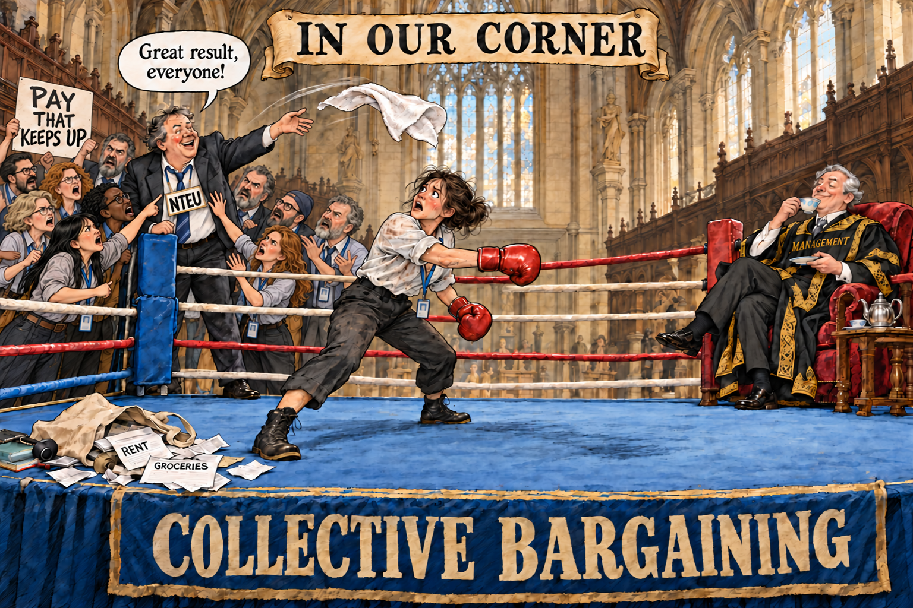

<style>
.university-calculation blockquote {
  font-size: 15px;
  line-height: 1.5;
  border-left: none;
  margin-top: 4px;
  margin-bottom: 10px;
  padding-top: 0;
  padding-bottom: 0;
  padding-left: 16px;
  padding-right: 16px;
}
.university-calculation blockquote p {
  margin-bottom: 0px;
  margin-top: 0px;
}

.scenario-table {
  width: 100%;
  overflow-x: auto;
  margin: 18px 0 22px;
}
.scenario-table table {
  width: 100%;
  min-width: 470px;
  table-layout: fixed;
  border-collapse: collapse;
  font-size: 16px;
  line-height: 1.45;
  color: #203038;
  margin: 0;
}
.scenario-table col:first-child { width: 44%; }
.scenario-table col:nth-child(2),
.scenario-table col:nth-child(3) { width: 28%; }
.scenario-table table.table th, .scenario-table table.table td {
  padding: 12px 16px;
  vertical-align: middle;
  border-bottom: 1px solid #dce3e6;
}
.scenario-table table.table thead th {
  background: transparent;
  font-weight: 600;
  border-top: 1px solid #dce3e6;
  border-bottom: 2px solid #c6d1d6;
}
.scenario-table table.table th:first-child, .scenario-table table.table td:first-child { text-align: left; }
.scenario-table table.table th:not(:first-child), .scenario-table table.table td:not(:first-child) {
  text-align: right;
  font-variant-numeric: tabular-nums;
}
.scenario-table table.table td:not(:first-child) { white-space: nowrap; }
.scenario-table .scenario-detail { font-size: 14px; color: #586771; }
@media (max-width: 600px) {
  .scenario-table table.table th, .scenario-table table.table td { padding: 10px; }
}
.methods-appendix { margin: 24px 0; }
.methods-appendix > summary { cursor: pointer; padding: 10px 0; }
.methods-appendix pre { overflow-x: auto; }

#header .author, #header .date { display: inline-block; font-size: 15px; font-weight: 400; margin: 8px 16px 20px 0; }
.cartoon { max-width: 620px; margin: 24px auto 28px; }
.cartoon img { width: 100%; max-width: 620px; height: auto; display: block; margin: 0 auto; }
.key-points { background: #F4F7F8; border-left: 4px solid #0072B2; border-radius: 4px; padding: 14px 20px 6px; margin: 20px 0 30px; }
.key-points p:first-child { margin-bottom: 8px; }
.key-points ul { padding-left: 20px; margin-bottom: 8px; }
.key-points li { margin-bottom: 8px; line-height: 1.5; }
#header .author { display: block; margin-bottom: 6px; line-height: 1.5; }
#header .author-affiliation { font-size: 14px; }
#header .date { margin-top: 0; }
.author-note { border-top: 1px solid #dce3e6; margin: 24px 0; padding: 10px 0 0; font-size: 14px; line-height: 1.45; }
.author-note p { margin-bottom: 8px; }
</style>

```{r setup, include=FALSE}
# Use project-installed dependencies when knitting directly in RStudio.
if (dir.exists(".local-library")) .libPaths(c(normalizePath(".local-library"), .libPaths()))
knitr::opts_chunk$set(echo=FALSE, message=FALSE, warning=FALSE)
# ggthemes' colour-blind-friendly palette, also used by scale_colour_colorblind().
# Explicit names preserve semantic colours across figures and keep Melbourne black.
public_palette <- setNames(ggthemes::colorblind_pal()(8),
  c('black','orange','sky_blue','bluish_green','yellow','blue','vermillion','purple'))
actual_colour <- unname(public_palette['black'])
protection_colour <- unname(public_palette['blue'])
demand_colour <- unname(public_palette['blue'])
noncash_colour <- unname(public_palette['orange'])
# One subtitle colour shared by every plot.
subtitle_colour <- '#586771'
public_caption_style <- ggplot2::element_text(size=9, face='plain', colour=subtitle_colour,
                                              hjust=0, margin=ggplot2::margin(t=8))
public_subtitle_style <- ggplot2::element_text(size=13, face='plain', colour=subtitle_colour,
                                               margin=ggplot2::margin(b=8))
# Calendar labels use the same June year-marker as the pay-versus-prices chart.
public_year_axis <- function(first, last, step=1L) {
  ggplot2::scale_x_date(breaks=as.Date(paste0(seq(first,last,by=step),'-06-30')),
                       date_labels='%Y', expand=c(0,0))
}
public_axis_style <- ggplot2::theme(
  panel.grid.minor=ggplot2::element_blank(),
  plot.title.position='plot',
  axis.text=ggplot2::element_text(size=10, colour=subtitle_colour),
  axis.title=ggplot2::element_text(size=10.5, colour=subtitle_colour),
  axis.title.y=ggplot2::element_text(margin=ggplot2::margin(r=10)),
  axis.title.x=ggplot2::element_text(margin=ggplot2::margin(t=10)))
# All five charts are constructed here in R; no saved charts or plot objects are loaded.
# Knit with this Rmd in the project root. Requires ggplot2, ggthemes, readabs, knitr and rmarkdown.
# Inputs are project-relative archived data. Peer CSVs are the bundled comparison
# datasets; their upstream sources and reconstruction scripts live in peer-evidence/
# and peer-evidence-unsw/. The Melbourne history is rebuilt from source tables.
# ---- public-history: calculated afresh on every knit ----
# Independent September 2026 build for the new public article.
# The frozen reference memo and its June/August outputs are not overwritten.
build_public_history <- function() {
  # Import the archived ABS release offline, preserving its series metadata.
  abs_data <- readabs::read_abs_local(
    filenames='cpi-quarterly-sep2026.xlsx', path='data/raw',
    use_fst=FALSE, metadata=TRUE)
  q <- subset(abs_data, series_id=='A2325846C')
  stopifnot(nrow(q)>0, all(q$series_type=='Original'),
            all(q$frequency=='Quarter'), all(q$unit=='Index Numbers'),
            all(q$sheet_no=='Data1'))
  q <- data.frame(period=format(as.Date(q$date), '%Y-%m'),
                  cpi=as.numeric(q$value))
  q <- subset(q, period >= '2003-09' & period <= '2026-09')
  q <- q[order(q$period), ]
  stopifnot(!anyNA(q), !anyDuplicated(q$period), tail(q$cpi,1)==103.64)
  quarter_end <- function(p) as.Date(format(as.Date(paste0(p,'-01'))+32,'%Y-%m-01'))-1
  price <- function(p) {v <- q$cpi[q$period==p]; stopifnot(length(v)==1); v}
  recovered <- read.csv('sources/historical-unique-dated-rates.csv')
  recovered$effective_date <- as.Date(recovered$effective_date)
  bridge <- read.csv('data/historical-2010-salary-schedules.csv')
  bench <- read.csv('data/historical-salary-benchmarks.csv')
  rises <- read.csv('data/historical-increases.csv')
  rises$scheduled_date <- as.Date(rises$scheduled_date)
  scales <- read.csv('data/salary-scales.csv')
  keys <- c('Academic B1'='B1','Academic C4'='C4',
            'Professional 5.1'='HEW5_1','Professional 7.1'='HEW7_1')
  full <- do.call(rbind,lapply(names(keys),function(cl) {
    out <- q
    out$classification <- cl
    anchor <- subset(bench,classification==cl & period=='2012-06')$annual_salary
    base <- subset(bench,classification==cl & period=='2003-09')$annual_salary
    stopifnot(length(anchor)==1, length(base)==1)
    out$annual_salary <- vapply(out$period,function(p) {
      if (p < '2009-06') {
        a <- recovered[recovered$effective_date <= quarter_end(p), ]
        a[which.max(a$effective_date), keys[[cl]]]
      } else if (p < '2012-06') {
        a <- subset(bridge, classification==cl & first_quarter<=p)
        a$annual_salary[which.max(as.Date(paste0(a$first_quarter,'-01')))]
      } else {
        anchor * prod(1+rises$rate[rises$scheduled_date<=quarter_end(p)])
      }
    },numeric(1))
    out$real_index <- 100 * (out$annual_salary/base)/(out$cpi/price('2003-09'))
    out$date <- quarter_end(out$period)
    out
  }))
  expected <- format(seq(as.Date('2003-09-01'),as.Date('2026-09-01'),by='3 months'),'%Y-%m')
  stopifnot(!anyNA(full),all(table(full$period)==4),identical(q$period,expected))
  checks <- merge(bench,full,by=c('classification','period'),suffixes=c('_table','_path'))
  stopifnot(nrow(checks)==nrow(bench),
            max(abs(checks$annual_salary_table/checks$annual_salary_path-1))<0.00004)
  # Verify the new endpoint independently against the published current scales.
  map <- data.frame(label=names(keys),classification=c('B','C','UOM5','UOM7'),increment=c(1,4,1,1))
  for(i in seq_len(nrow(map))) {
    a <- subset(scales,classification==map$classification[i] & increment==map$increment[i] & scheduled_date<='2026-09-30')
    salary <- a$annual_salary[which.max(as.Date(a$scheduled_date))]
    reconstructed <- subset(full,classification==map$label[i] & period=='2026-09')$annual_salary
    stopifnot(length(reconstructed)==1,abs(salary/reconstructed-1)<0.00004)
  }
  h <- aggregate(real_index~period,full,mean)
  h$date <- quarter_end(h$period)
  value <- function(p) h$real_index[h$period==p]
  result <- list(history=h,points=full,
    loss=1-value('2026-09')/value('2017-06'),
    pre_surge=value('2021-12')/value('2017-06')-1,
    after_2021=value('2026-09')/value('2021-12')-1,
    versus_2012=value('2026-09')/value('2012-06')-1)
  stopifnot(round(100*result$loss,1)==6.4,abs(result$pre_surge)<0.01)
  result
}

public_history <- build_public_history()
h <- public_history$history
val <- function(p) h$real_index[h$period==p]
endpoint <- tail(h,1)
library(ggplot2)
# Illustrative historical benchmarks, using quarter spacing for annual growth.
quarter_number <- function(p) as.integer(substr(p,1,4))*4+as.integer(substr(p,6,7))/3
public_historical_growth <- (val('2017-06')/val('2003-09'))^(1/13.75)-1
public_history_benchmarks <- subset(h,period>='2017-06',select=c(period,date))
public_history_benchmarks$years <- (quarter_number(public_history_benchmarks$period)-quarter_number('2017-06'))/4
public_history_benchmarks$cpi_only <- val('2017-06')
public_history_benchmarks$one_percent_real <- val('2017-06')*1.01^public_history_benchmarks$years
public_history_benchmarks$earlier_growth <- val('2017-06')*(1+public_historical_growth)^public_history_benchmarks$years
stopifnot(round(100*public_historical_growth,2)==1.54,
          public_history_benchmarks$years[1]==0,
          all(public_history_benchmarks$earlier_growth>=public_history_benchmarks$one_percent_real),
          all(public_history_benchmarks$one_percent_real>=public_history_benchmarks$cpi_only))
bl <- tail(public_history_benchmarks,1)
ld <- as.Date('2027-01-15')
public_history_plot <- ggplot(h,aes(date,real_index))+
  geom_hline(yintercept=100,colour='#BFC8CD',linewidth=.4,linetype='dashed')+
  geom_vline(xintercept=as.Date('2017-06-30'),colour='#C4CDD1',linewidth=.4,linetype='dotted')+
  geom_line(data=public_history_benchmarks,aes(y=earlier_growth),colour=unname(public_palette['purple']),linewidth=.7,linetype='longdash')+
  geom_line(data=public_history_benchmarks,aes(y=one_percent_real),colour=unname(public_palette['bluish_green']),linewidth=.7,linetype='dashed')+
  geom_line(data=public_history_benchmarks,aes(y=cpi_only),colour=protection_colour,linewidth=1.05)+
  geom_line(colour=actual_colour,linewidth=1.25)+
  geom_point(data=subset(h,period %in% c('2017-06','2026-09')),colour=actual_colour,size=2.6)+
  annotate('text',x=ld,y=bl$earlier_growth,hjust=0,vjust=.5,
           label=sprintf('Earlier gains continue\n%.2f%% real growth a year',100*public_historical_growth),
           size=3.4,colour=unname(public_palette['purple']),lineheight=1.15)+
  annotate('text',x=ld,y=bl$one_percent_real,hjust=0,vjust=.5,
           label='1% real growth a year',size=3.4,colour=unname(public_palette['bluish_green']))+
  annotate('text',x=ld,y=bl$cpi_only,hjust=0,vjust=.5,
           label='Keeping pace with CPI\nPurchasing power maintained',size=3.5,fontface='bold',colour=protection_colour,lineheight=1.15)+
  annotate('text',x=ld,y=endpoint$real_index,hjust=0,vjust=.5,
           label=sprintf('Actual pay\n%.1f%% below CPI protection',100*public_history$loss),
           size=3.8,fontface='bold',colour=actual_colour,lineheight=1.15)+
  annotate('text',x=as.Date('2017-10-01'),y=103,hjust=0,vjust=0,
           label='June 2017\nScheduled end of the 2013 agreement',size=3.2,colour='#687981',lineheight=1.15)+
  public_year_axis(2004,2026,step=2)+
  scale_y_continuous(breaks=seq(100,140,10),minor_breaks=NULL)+
  coord_cartesian(xlim=as.Date(c('2003-09-30','2026-09-30')),ylim=c(97,146),clip='off')+
  labs(title='Even keeping pace with inflation would have delivered higher pay',
       subtitle='Actual salary purchasing power, September 2003–September 2026; three benchmarks from June 2017',
       x=NULL,y='Inflation-adjusted salary index\nSeptember 2003 = 100',
       caption='Sources: university salary schedules and agreements; ABS national CPI. Dashed paths are illustrative, not forecasts.')+
  theme_minimal(base_size=12)+
  theme(panel.grid.major.x=element_blank(),panel.grid.major.y=element_line(colour='#E4E8EB',linewidth=.4),
        plot.title=element_text(face='bold',size=17,colour='#203038'),
        plot.subtitle=public_subtitle_style,
        plot.title.position='plot',
        plot.caption.position='plot',plot.caption=public_caption_style,
        axis.title.y=element_text(size=10.5,margin=margin(r=10)),
        plot.margin=margin(14,185,12,14))

# ---- public-peers: calculated afresh on every knit ----
# Use the same June 2017 baseline as the preceding Melbourne history.
p <- read.csv('peer-evidence/data/derived/september2026/recent-paths.csv')
p <- subset(p, baseline=='2017-06-01')
# Rebase UNSW's individual salary points to June 2017, then average.
up <- read.csv('peer-evidence-unsw/data/derived/six-university-comparison/historical-point-paths.csv')
up <- subset(up,university=='UNSW')
ub <- subset(up,date=='2017-06-01',select=c(classification,annual_salary,cpi))
names(ub)[2:3] <- c('salary_base','cpi_base')
u <- merge(subset(up,date>='2017-06-01'),ub,by='classification')
u$real_index <- 100*(u$annual_salary/u$salary_base)/(u$cpi/u$cpi_base)
um <- aggregate(real_index~date,u,mean)
um$university <- 'UNSW'
p <- rbind(p[c('date','university','real_index')],um[c('date','university','real_index')])
# Peer CSV dates identify quarters by their first day; plot at quarter end,
# consistently with the Melbourne history and pay-versus-prices figures.
p$date <- as.Date(format(as.Date(p$date)+32,'%Y-%m-01'))-1
ends <- subset(p,date==as.Date('2026-09-30'))
stopifnot(nrow(ends)==6,abs(ends$real_index[ends$university=='Melbourne']/100-1+public_history$loss)<1e-10)
# Endpoint sensitivity: one Melbourne rise, with prices and peers' pay unchanged.
# This is an illustration, not a prediction at the eventual implementation date.
public_peer_endpoints <- ends
public_peer_first_rise <- ends$real_index[ends$university=='Melbourne'] * 1.035
public_peer_median <- median(ends$real_index[ends$university!='Melbourne'])
public_peer_first_rank <- 1L + sum(ends$real_index[ends$university!='Melbourne'] > public_peer_first_rise)
stopifnot(public_peer_first_rank==4L, public_peer_first_rise < public_peer_median)
ends$label_y <- c(Monash=99.6,UNSW=98.7,ANU=97.8,UQ=96.7,Sydney=95.8,Melbourne=93.4)[ends$university]
ends$label <- paste0(ends$university,'  ',sprintf('%+.1f%%',ends$real_index-100))
cols <- setNames(unname(public_palette[c('black','bluish_green','blue','vermillion','orange','purple')]),
                 c('Melbourne','Monash','Sydney','ANU','UQ','UNSW'))
peer_shapes <- c(Melbourne=16,Monash=17,Sydney=15,ANU=18,UQ=8,UNSW=3)
public_peer_plot <- ggplot(p,aes(date,real_index,colour=university,group=university))+
 geom_hline(yintercept=100,linetype='dashed',colour='#68727d',linewidth=.5)+
 geom_line(linewidth=1.1)+geom_point(aes(shape=university),size=2.2,stroke=.8)+
 geom_segment(data=ends,aes(xend=as.Date('2027-01-01'),yend=label_y),linewidth=.45)+
 geom_text(data=ends,aes(x=as.Date('2027-03-01'),y=label_y,label=label),hjust=0,fontface='bold',size=3.7)+
 scale_colour_manual(values=cols)+
 scale_shape_manual(values=peer_shapes)+
 public_year_axis(2017,2026)+
 scale_y_continuous(breaks=seq(94,104,2),labels=function(x) sprintf('%.0f',x),minor_breaks=NULL)+
 coord_cartesian(xlim=as.Date(c('2017-05-01','2026-09-30')),ylim=c(93,103),clip='off')+
 labs(title='By September 2026, Melbourne had lost the most purchasing power',
 subtitle='Melbourne’s pay buys 6.4% less than in June 2017; losses at the five peers range from 0.8% to 3.5%.',
 x=NULL,y='Inflation-adjusted salary index\nJune 2017 = 100',
 caption='June 2017–September 2026. Sources: university salary schedules and agreements; ABS national CPI.')+
 theme_minimal(base_size=12)+theme(legend.position='none',panel.grid.minor=element_blank(),panel.grid.major.x=element_blank(),plot.title=element_text(face='bold',size=15),plot.subtitle=public_subtitle_style,plot.caption.position='plot',plot.caption=public_caption_style,plot.margin=margin(20,155,18,24))

# ---- public-forward: calculated afresh on every knit ----
# Conditional expiry outcomes using the September 2026 quarterly CPI vintage.
# Uses the history rebuilt above. No monthly/quarterly splicing or forecast fitting.
public_forward_start <- as.Date('2026-09-30')
public_forward_end <- as.Date('2030-04-10')
public_forward_years <- as.numeric(public_forward_end-public_forward_start)/365.2425
public_forward_factor <- 1.035^4
fh <- public_history$history
fv <- function(p) {v <- fh$real_index[fh$period==p];stopifnot(length(v)==1);v}
public_forward_bases <- c('2017-06','2019-12','2021-12','2026-09')
public_forward_value <- function(b,r) 100*(fv('2026-09')/fv(b)*public_forward_factor/(1+r)^public_forward_years-1)
public_forward_threshold <- function(b) (fv('2026-09')/fv(b)*public_forward_factor)^(1/public_forward_years)-1
public_forward_table <- expand.grid(baseline=public_forward_bases,inflation=c(.02,.025,.035,.04,.043,.05,.06),stringsAsFactors=FALSE)
public_forward_table$real_change_pct <- mapply(public_forward_value,public_forward_table$baseline,public_forward_table$inflation)
public_forward_thresholds <- data.frame(baseline=public_forward_bases,annual_inflation=sapply(public_forward_bases,public_forward_threshold),row.names=NULL)
stopifnot(abs(public_forward_factor-1.147523000625)<1e-12,
          all(abs(mapply(public_forward_value,public_forward_bases,public_forward_thresholds$annual_inflation))<1e-10),
          abs(public_forward_value('2026-09',0)-100*(public_forward_factor-1))<1e-10)
for(b in public_forward_bases) stopifnot(all(diff(sapply(seq(.02,.06,.01),function(r) public_forward_value(b,r)))<0))
# Compare the member-approved 20% demand at the same April 2030 endpoint.
# Assume implementation by its conditional September 2029 expiry, then no
# further increases. This is our comparison assumption, not a proposed freeze.
public_claim_factor <- 1.20
public_claim_value <- function(b,r) 100*(fv('2026-09')/fv(b)*public_claim_factor/(1+r)^public_forward_years-1)
public_demand_comparison <- public_forward_table
names(public_demand_comparison)[3] <- 'settlement_real_change_pct'
public_demand_comparison$claim_real_change_pct <- mapply(public_claim_value,public_demand_comparison$baseline,public_demand_comparison$inflation)
public_demand_salary_gap <- 100000*(public_claim_factor-public_forward_factor)
stopifnot(all(abs((1+public_demand_comparison$claim_real_change_pct/100)/
 (1+public_demand_comparison$settlement_real_change_pct/100)-public_claim_factor/public_forward_factor)<1e-12),
 all(public_demand_comparison$claim_real_change_pct>public_demand_comparison$settlement_real_change_pct))
# Three explicit benchmarks, with reference points only at the two labelled rates.
curves <- expand.grid(baseline=c('2017-06','2019-12','2026-09'),inflation=seq(.02,.06,length.out=201),stringsAsFactors=FALSE)
curves$real_change_pct <- mapply(public_forward_value,curves$baseline,curves$inflation)
ends <- subset(curves,inflation==.06)
ends$label <- c('2017-06'='Compared with\nJune 2017',
                '2019-12'='Compared with\npre-pandemic pay\n(December 2019)',
                '2026-09'='Compared with today\n(September 2026)')[ends$baseline]
ends$label_y <- c('2017-06'=-14,'2019-12'=-10.5,'2026-09'=public_forward_value('2026-09',.06))[ends$baseline]
public_forward_plot <- ggplot(curves,aes(inflation*100,real_change_pct,colour=baseline))+
 annotate('rect',xmin=2,xmax=3,ymin=-Inf,ymax=Inf,fill='#EEEEEE',alpha=.75)+
 annotate('text',x=2.5,y=8.7,label='RBA target: 2–3%',size=3.5,colour='#586771')+
 geom_hline(yintercept=0,colour='#56636C',linewidth=.65)+
 geom_vline(xintercept=c(3.5,4.3),colour='#AEBAC0',linetype='dotted',linewidth=.5)+
 annotate('text',x=3.56,y=8.0,label='3.5%: proposed\nannual pay rise',hjust=0,vjust=1,size=3.4,colour='#586771',lineheight=1.15)+
 annotate('text',x=4.36,y=8.0,label='4.3%: latest\nannual inflation',hjust=0,vjust=1,size=3.4,colour='#586771',lineheight=1.15)+
 geom_line(aes(linetype=baseline),linewidth=1.15)+
 geom_point(data=subset(public_forward_table,baseline %in% c('2017-06','2019-12','2026-09') & inflation %in% c(.035,.043)),size=2.3)+
 geom_segment(data=ends,aes(x=6,xend=6.13,yend=label_y),linewidth=.45)+
 geom_text(data=ends,aes(x=6.18,y=label_y,label=label),hjust=0,fontface='bold',size=3.6,lineheight=1.15)+
 annotate('text',x=4.5,y=.65,label='Above zero = better off\nBelow zero = worse off',hjust=0,vjust=0,size=3.5,colour='#56636C',lineheight=1.2)+
 scale_colour_manual(values=setNames(unname(public_palette[c('orange','blue','black')]),c('2017-06','2019-12','2026-09')))+
 scale_linetype_manual(values=c('2017-06'='longdash','2019-12'='solid','2026-09'='solid'))+
 scale_x_continuous(breaks=seq(2,6,.5),labels=function(x) paste0(x,'%'),expand=c(0,0))+
 scale_y_continuous(breaks=seq(-15,5,5),labels=function(x) paste0(x,'%'),expand=c(0,0))+
 coord_cartesian(xlim=c(1.9,6.05),ylim=c(-15,9.5),clip='off')+
 labs(title='At 4.3% average inflation, the deal would cut real pay again',
 subtitle=sprintf('By April 2030, pay would buy %.1f%% less than in September 2026',-public_forward_value('2026-09',.043)),
 x='Average annual inflation, September 2026 to April 2030',y='Change in what pay can buy',
 caption='Scenarios, not forecasts. Sources: proposed pay rises; university salary schedules; ABS national CPI.')+
 theme_minimal(base_size=12)+theme(legend.position='none',panel.grid.minor=element_blank(),panel.grid.major.x=element_blank(),plot.title=element_text(face='bold',size=16),plot.subtitle=public_subtitle_style,plot.caption.position='plot',plot.caption=public_caption_style,plot.margin=margin(20,160,18,24))

# ---- public-explainers: calculated afresh on every knit ----
# Reproducible public charts: offer composition and pay versus prices.
library(ggplot2)
ink <- '#203038'; muted <- '#586771'
base_theme <- theme_minimal(base_size=12)+theme(panel.grid.minor=element_blank(),plot.title=element_text(face='bold',size=22,colour=ink),plot.subtitle=public_subtitle_style,plot.caption.position='plot',plot.caption=public_caption_style,plot.title.position='plot',plot.margin=margin(20,26,18,24))
pay <- 100*(1.035^4-1)
bars <- data.frame(row=c(3,1,1,2),start=c(0,0,pay,0),end=c(20,pay,18.2,pay),fill=c(demand_colour,actual_colour,noncash_colour,actual_colour))
labels <- data.frame(row=c(3,1,2),label=c('What union members demanded','How the VC gets to 18.2%','The proposal NTEU leadership has accepted'))
# Tighter row spacing for an infographic layout.
bars$row <- bars$row * 0.8
labels$row <- labels$row * 0.8
p <- ggplot()+
 geom_rect(data=bars,aes(xmin=start,xmax=end,ymin=row-.23,ymax=row+.23,fill=I(fill)))+
 geom_text(data=labels,aes(x=0,y=row+.34,label=label),hjust=0,fontface='bold',size=4.8,colour=ink)+
 annotate('text',x=10,y=2.4,label='20% salary increase',colour='white',fontface='bold',size=4.5)+
 annotate('text',x=pay/2,y=c(1.6,.8),label='14.75% salary increase',colour='white',fontface='bold',size=4.5)+
 annotate('text',x=(pay+18.2)/2,y=.8,label='~3.4%\nleave value',colour=ink,fontface='bold',size=4.5)+
 annotate('text',x=21.2,y=2.4,label='$120,000 salary',hjust=0,fontface='bold',size=5.3,colour=demand_colour)+
 annotate('text',x=21.2,y=.8,label='$118,200 "earnings"',hjust=0,fontface='bold', size=5.3,
          colour=ink)+
#annotate('text',x=21.2,y=1.07,label='18.2% package headline',hjust=0,fontface='bold',size=4.3,colour=ink)+
 #annotate('text',x=21.2,y=0.86,label='Salary still $114,752',hjust=0,size=4,colour=actual_colour)+
 annotate('text',x=21.2,y=1.6,label='$114,752 salary',hjust=0,fontface='bold',size=5.3,colour=actual_colour)+
 scale_x_continuous(limits=c(0,31),breaks=NULL,expand=c(0,0))+
 scale_y_continuous(limits=c(.52,2.85),breaks=NULL,expand=c(0,0))+
 labs(title='Leave is not a pay rise', subtitle='If you earn $100,000 now, the deal takes your annual salary to $114,752 by late 2029.', x=NULL, y=NULL,
 caption='Sources: NTEU pay claim and bargaining updates; university Staff Hub salary example.')+
 base_theme+theme(plot.subtitle=public_subtitle_style,plot.margin=margin(8,26,8,24),panel.grid=element_blank(),axis.title=element_blank(),axis.text=element_blank(),axis.ticks=element_blank(),plot.caption.position='plot',plot.caption=public_caption_style)
public_offer_plot <- p

raw <- public_history$points # Rebuilt above from salary schedules and the ABS workbook.
raw$date <- as.Date(raw$date)
ref <- subset(raw,period=='2017-06',select=c(classification,annual_salary,cpi))
names(ref)[2:3] <- c('salary_ref','cpi_ref')
d <- merge(subset(raw,period>='2017-06'),ref,by='classification')
d$pay <- 100000*d$annual_salary/d$salary_ref
d$prices <- 100000*d$cpi/d$cpi_ref
a <- aggregate(cbind(pay,prices)~date,d,mean)
h <- rbind(data.frame(date=a$date,value=a$pay,series='Melbourne pay'),data.frame(date=a$date,value=a$prices,series='Pay needed to match prices'))
end <- subset(h,date==max(date))
end$label <- paste0(ifelse(end$series=='Melbourne pay','Actual pay','With inflation protection'),
                       '\n$',format(round(end$value),big.mark=',',trim=TRUE))
public_price_gap <- tail(a$prices-a$pay,1)
gap_low <- tail(a$pay,1)
gap_high <- tail(a$prices,1)
gap_date <- max(a$date) + 80
label_date <- max(a$date) + 165
stopifnot(abs(gap_low-126202.4706)<.1,abs(gap_high-134807.4922)<.1)
public_pay_prices_plot <- ggplot(h,aes(date,value,colour=series))+
 geom_ribbon(data=a,aes(x=date,ymin=pmin(pay,prices),ymax=prices),inherit.aes=FALSE,fill=protection_colour,alpha=.16)+
 geom_hline(yintercept=100000,colour='#C9D0D3',linetype='dashed')+
 geom_line(aes(linetype=series),linewidth=1.25)+geom_point(data=end,size=2.7)+
 annotate('point',x=as.Date('2017-06-30'),y=100000,size=2.7,colour=ink)+
 annotate('segment',x=as.Date('2017-06-30'),xend=as.Date('2017-06-30'),y=100700,yend=103600,colour=muted,linewidth=.5)+
 annotate('text',x=as.Date('2017-07-15'),y=105700,label='June 2017\n$100,000 salary',hjust=0,fontface='bold',size=4,colour=ink)+
 geom_text(data=end,aes(x=label_date,label=label),hjust=0,fontface='bold',size=3.8,show.legend=FALSE)+
 annotate('segment',x=gap_date,xend=gap_date,y=gap_low,yend=gap_high,colour=ink,linewidth=.7)+
 annotate('segment',x=gap_date-40,xend=gap_date+40,y=gap_low,yend=gap_low,colour=ink,linewidth=.7)+
 annotate('segment',x=gap_date-40,xend=gap_date+40,y=gap_high,yend=gap_high,colour=ink,linewidth=.7)+
 annotate('text',x=label_date,y=(gap_low+gap_high)/2,
          label=paste0('$',format(round(public_price_gap),big.mark=',',trim=TRUE),' annual shortfall'),
          hjust=0,fontface='bold',size=4.2,colour=ink)+
 scale_colour_manual(values=c('Melbourne pay'=actual_colour,'Pay needed to match prices'=protection_colour))+
 scale_linetype_manual(values=c('Melbourne pay'='solid','Pay needed to match prices'='longdash'))+
 scale_y_continuous(breaks=seq(100000,135000,10000),labels=function(x)paste0('$',round(x/1000),'k'),limits=c(99000,138000),expand=c(0,0))+
 public_year_axis(2017,2026)+
 coord_cartesian(xlim=as.Date(c('2017-05-01','2026-09-30')),clip='off')+
 labs(title=sprintf("We've lost %.1f%% in purchasing power under the last two agreements",100*public_history$loss),
      subtitle='Salary for a job paying $100,000 in June 2017',x=NULL,y=NULL,
      caption='June 2017–September 2026. Sources: university salary schedules and agreements; ABS national CPI.')+
 base_theme+theme(legend.position='none',panel.grid.major.x=element_blank(),
                  plot.title=element_text(face='bold',size=18,colour=ink),
                  plot.subtitle=public_subtitle_style,
                  plot.caption.position='plot',plot.caption=public_caption_style,
                  plot.margin=margin(20,190,18,24))
# Apply identical axis typography to all four quantitative charts.
# The offer infographic intentionally has no axes.
public_pay_prices_plot <- public_pay_prices_plot + public_axis_style
public_history_plot <- public_history_plot + public_axis_style
public_peer_plot <- public_peer_plot + public_axis_style
public_forward_plot <- public_forward_plot + public_axis_style
salary_increase_pct <- 100 * (1.035^4 - 1)
loss_pct <- 100 * public_history$loss
catchup_per100k <- 100000 * (1/(1-public_history$loss)-1)
```


::: {.opening}

On 27 October 2026, the University of Melbourne Vice-Chancellor emailed staff to announce that University management had reached an agreement in principle with the National Tertiary Education Union (NTEU) on pay and working conditions. The VC described the package as offering “sector leading entitlements”. The “salary increases and additional leave combined”, we are told, amount to **“an 18.2% increase over four years”**. [Read the VC’s announcement](https://vcmail.unimelb.edu.au/banner-items/enterprise-agreement-in-principle-agreement-includes-salary-increases-and-additional-leave2).

::: {.key-points}

**The TL;DR on Melbourne's proposed Enterprise Agreement:**

* **14.75% salary increase over four years, not 18.2%.** The university's 18.2% headline treats two extra days of shutdown leave as "earnings". You can't pay rent with the estimated value of your Christmas break.
* **Our pay is still exposed to more real wage cuts.** Prices rose 4.3% over the past year, and this deal includes four annual pay rises of 3.5%.[^current-inflation] That's a bet on inflation falling. The last two agreement made the same bet, and staff lost. 
* **We've already lost 6.4% in purchasing power under the last two agreements.** Between June 2017 and September 2026, we've lost more than staff at Monash, UNSW, ANU, UQ and Sydney. "Sector leading"?
* **Our pay now buys roughly what it did in 2012.** Recovering even December 2019 purchasing power under the proposed deal requires persistently low inflation -- averaging 2.25% or less through April 2030.
* **The pay rise is below what union members voted for.** Members demanded 20% in March, and the NTEU was still seeking 20% over three years on 15 October. Leadership needs to explain how this became 14.75% over four years.
:::

**Management and the NTEU leadership may be satisfied with this deal, but we do not have to accept it.**

Staff deserve a clear explanation of what this agreement delivers, and why pay concessions were made so quickly. This memo critically evaluates several of the arguments for accepting this deal that we're likely to hear from both management and the NTEU in the coming weeks. In my assessment, none of them are convincing.

:::

## But doesn't this deal increase our earnings by 18.2%? No.

Here is the University's claim and their example calculation for the so-called "compounded earnings" they're offering staff:  

::: {.university-calculation}
> The University is proposing EA salary increases of 3.5% per annum over four years, along with two days of
> additional paid leave during the annual end-of-year shutdown. The compounding effect of this combined equates to an **18.2% increase over four years.**
>
> **Example: proposed compounded increase in earnings based on a salary of \$100,000:**
>
> - **Year 1:** \$100,000 + 3.5% = \$103,500 + 2 days paid leave (~0.76% = 2/261 weekdays a year)
> - **Year 2:** \$103,500 + 3.5% = \$107,122.50 + 2 days paid leave (~0.76%)
> - **Year 3:** \$107,122.50 + 3.5% = \$110,871.78 + 2 days paid leave (~0.76%)
> - **Year 4:** \$110,871.78 + 3.5% = \$114,752.30 + 2 days paid leave (~0.76%)
> - **Total:** compounding increase of 18.2% over four years (14.8% base salary + 3.4% paid leave)
>

:::

**This is a misleading presentation, not an 18.2% pay increase.** Four salary increases of 3.5% compound to 14.75%. To reach the "compounding increase of 18.2%" figure, the university combines salary with what they reckon 2 days leave is worth:[^leave-calculation]

- Salary alone: $(1.035^4 - 1) \times 100 \approx 14.75\%$
- Salary plus attributed leave value: $((1 + 0.035 + 2/261)^4 - 1) \times 100 \approx 18.19\%$

This calculation also treats these two days as a *new* percentage increase each year, but two days don't grow to four, six and eight. Annual salary increases build upon previous increases, but two days in 2026 is still two days in 2030.

**A recurring benefit is not a recurring increase.** If we instead count those two days once then the combined increase is only **15.6%** using the university's own valuation.[^leave-calculation] 

```{r offer-breakdown, fig.width=13, fig.height=4.5, out.width='100%', fig.alt='Members demanded 20 percent salary growth. The proposed four rises deliver 14.75 percent. The university reaches its 18.2 percent package headline by adding an attributed leave value, shown in orange, which is not additional salary.'}
public_offer_plot
```

An 18.2% increase over four years is about 4.3% a year -- matching the latest annual inflation rate published by the ABS.[^current-inflation] But the actual salary increases are only 3.5% per year, and the leave valuation adds nothing to our paychecks. You can't buy groceries or pay rent with the estimated value of your Christmas break.

## But doesn't 3.5% keep up with current inflation? No.

The proposed agreement offers four fixed pay rises of 3.5% per year, but inflation was 4.3% over the past year alone.[^current-inflation] If inflation averages above 3.5% then this "pay rise" will be yet another pay cut in real terms.

**Yes, we've been here before.** The 2018 and 2024 agreements also set fixed pay rises with no protection against inflation.[^cpi-agreements] For example, a job that paid \$100,000 in June 2017 now pays \$126,202. Just keeping up with inflation would require \$134,807 -- that's \$8,605 a year less than needed to avoid going backwards.[^pay-prices-example]

```{r pay-prices, fig.width=12.5, fig.height=6.5, out.width='100%', fig.alt='Pay has lost 6.4 percent of its purchasing power since June 2017. A job paying 100000 dollars then pays 126202 dollars by September 2026; inflation protection would require 134807 dollars. The labelled annual salary shortfall is 8605 dollars.'}
public_pay_prices_plot
```

**This is not complicated.** At a bare minimum, unions should negotiate agreements with pay rises of a set percentage or CPI, whichever is higher. If inflation falls below the set rise, we come out a little bit better; otherwise, our pay at least keeps pace with the cost of living.

A decent agreement would also make up for what workers lost to inflation under the last two agreements. Matching pay to future inflation only stops the losses from growing. It doesn’t win back the 6.4% of purchasing power that we have already lost.

**Inflation protection is achievable.** At Ausgrid, for example, the Electrical Trades Union and others have recently secured an agreement that ties pay to a modest increase or CPI, whichever is higher, for 2025 and 2026.[^inflation-protection-examples] 

The NTEU has asked for this before. In 2023, its own claim was 5% or CPI plus 1.5%, whichever was greater, for the May 2024 and May 2025 pay rises. That guarantee was, however, not in the agreement staff were asked to vote on.[^cpi-demand] After two agreements that have cut real wages by 6.4%, why are we being asked to take the same risk a third time?

## But hasn't it always been like this? No.

From 2003 to 2017, Melbourne's negotiated pay rises had outpaced inflation, so **staff actually gained purchasing power**. Since June 2017 -- when the 2013 bargaining agreement expired -- those gains have stalled and gone into reverse.

**By September 2026, our pay bought about `r sprintf('%.1f%%', loss_pct)` less than it did in June 2017, or roughly what it bought in 2012.** For someone earning \$100,000 today, simply restoring their June 2017 purchasing power would require an additional \$`r formatC(catchup_per100k, format='f', digits=0, big.mark=',')` more a year, before any future inflation. [Calculation and sources](#methods).

```{r history, fig.width=12.5, fig.height=7.2, out.width='100%', fig.alt="Actual inflation-adjusted pay through September 2026 ends 6.4 percent below the horizontal June 2017 purchasing-power benchmark. Two lighter dashed paths show illustrative 1 percent annual real growth and continuation of earlier growth of about 1.54 percent. These are benchmarks, not forecasts."}
public_history_plot
```

The solid horizontal line in the plot above shows what simply maintaining June 2017 purchasing power would have meant for wages. The dashed lines show two illustrative counter-factual paths that *could* have happened, and both involve small real gains: 1) the roughly 1.5% a year staff averaged from 2003 to 2017; or 2) a little less at 1% a year.[^historical-chart] 

We’ve transitioned from a period where it was normal for real wages to grow a little bit over time to one where we're being asked to accept pay that falls short of even standing still. 


## But haven't we been getting "sector-leading" pay deals? No.

It's true that inflation has hit workers across the university sector. The [VC's announcement](https://vcmail.unimelb.edu.au/banner-items/enterprise-agreement-in-principle-agreement-includes-salary-increases-and-additional-leave2) described the proposed package as offering “sector-leading entitlements”, including pay competitive with sector wage growth and living costs. So how does Melbourne's pay actually compare with peer institutions? 

**Between June 2017 and September 2026, Melbourne lost more purchasing power than any of the five peers examined.** We lost 6.4%, compared with 0.8% at Monash, 1.3% at UNSW, 1.6% at ANU, 3.3% at UQ and 3.5% at Sydney.[^peer-chart]

```{r peers, fig.width=12.5, fig.height=6.5, out.width='100%', fig.alt='Purchasing-power changes from June 2017 to September 2026: Melbourne minus 6.4 percent, Sydney minus 3.5, UQ minus 3.3, ANU minus 1.6 and Monash minus 0.8, and UNSW minus 1.3. Pay for the same academic and professional jobs over time, adjusted using the same national CPI.'}
public_peer_plot
```

These rankings change as pay rises take effect, and Melbourne has not been last throughout this period. But by September 2026, Melbourne staff had **lost more purchasing power** than staff at any of the above peer institutions.[^peer-timing] Therefore, the question for management and NTEU leadership remains: with more ground to recover, why is this proposed agreement "sector-leading"?


## But won't this deal at least make up for recent losses? Unlikely.

Improving on today's reduced pay is not the same as recovering what staff have lost over the past several years. But will four increases of 3.5% at least restore pre-pandemic purchasing power? **Only if inflation averages about `r sprintf('%.2f%%',100*public_forward_threshold('2019-12'))` or less from September 2026 to April 2030.** Even at 2.5% -- the middle of the Reserve Bank's target range -- pay would be about `r sprintf('%.1f%%',-public_forward_value('2019-12',.025))` below December 2019 purchasing power.[^recovery-method]

```{r forward, fig.width=12.5, fig.height=7.2, out.width='100%', fig.alt='At 4.3 percent average annual inflation through April 2030, the deal leaves purchasing power 1.1 percent below September 2026. Three lines compare the outcome with September 2026, December 2019 and June 2017. The shaded RBA target range is 2 to 3 percent. Labelled dotted lines mark the proposed 3.5 percent annual rise and the latest annual inflation rate of 4.3 percent.'}
public_forward_plot
```

Here is a summary of what the proposed deal would deliver by April 2030 under different scenarios:[^inflation-range]

::: {.scenario-table}

| Average annual inflation | Purchasing power vs December 2019 | Purchasing power vs September 2026 |
|:--|--:|--:|
| **2%:** <span class="scenario-detail">bottom of the RBA target range</span> | `r sprintf('%.1f%% higher',public_forward_value('2019-12',.02))` | `r sprintf('%.1f%% higher',public_forward_value('2026-09',.02))` |
| **3.5%:** <span class="scenario-detail">matching the proposed annual rise</span> | `r sprintf('%.1f%% lower',-public_forward_value('2019-12',.035))` | `r sprintf('%.1f%% higher',public_forward_value('2026-09',.035))` |
| **4.3%:** <span class="scenario-detail">the latest annual inflation rate</span> | `r sprintf('%.1f%% lower',-public_forward_value('2019-12',.043))` | `r sprintf('%.1f%% lower',-public_forward_value('2026-09',.043))` |
| **6%:** <span class="scenario-detail">a higher-inflation scenario</span> | `r sprintf('%.1f%% lower',-public_forward_value('2019-12',.06))` | `r sprintf('%.1f%% lower',-public_forward_value('2026-09',.06))` |

:::

At 3.5% average inflation, **members’ 20% demand would roughly restore pre-pandemic purchasing power by April 2030. The proposed deal would leave us `r sprintf('%.1f%%',-public_forward_value('2019-12',.035))` behind.**[^demand-comparison]


## But didn't the NTEU win enough in return? Unlikely.

In March 2026, union members demanded a 20% pay rise over three years. By 15 October, the NTEU was still seeking that increase.[^member-demand] That's roughly what it would take to restore December 2019 purchasing power by April 2030 if inflation averages 3.5%.[^demand-comparison] The proposed agreement offers four 3.5% rises, about 15% over four years. That is a substantial concession, so what did staff get in return?

Some gains seem real, such as 17% superannuation for casual staff, although even that only starts in April 2029.[^casual-super] On academic workloads, however, the proposed changes add more bureaucratic processes without guaranteeing better outcomes. 

Our existing agreement already requires an annual workload discussion, allows staff to request reviews, requires the university to implement necessary adjustments after a review, and requires a university-wide review of workload practices.[^workload-existing] The proposed agreement adds faculty guidelines with indicative time allocations, consultation requirements and a mandatory mid-year check-in.[^workload-nteu] **Another meeting is not a workload reduction.**

Union members asked for staff-majority workload committees with final decision-making authority, and staff approval by ballot before workloads take effect.[^workload-demand] The proposed workload provisions deliver neither. Instead, the existing obligation to implement "any necessary adjustments" becomes adjustments "that the University may determine". The university must consider excess work when setting subsequent workloads, but the draft does not guarantee a workload reduction.[^workload-nteu]

The new deal also gives academics just ten days to request a review after noticing a mismatch between their workload plan and the work expected of them. The existing review clause has no equivalent deadline.[^workload-nteu] Do these new workload provisions justify giving up workers' pay demands when they still leave it up to management to decide what adjustments to make? Why are workers being asked to give up their pay demand for
provisions that leave the remedy to management and put a new deadline on staff raising
concerns?

The timing of all this raises sharper questions. By 15 October, the NTEU had already agreed in principle to extra shutdown leave over the Christmas break, as well as arrangements to address professional staff absences after two weeks instead of four. At that point, it was still seeking a 20% pay rise over the next three years.[^oct15] 

The later announcement included superannuation for casuals in 2029, more workload procedures, and changes on academic freedom and AI, which were still unresolved on 15 October.[^later-gains] **Is this what the NTEU leadership has accepted in exchange for dropping the 20% pay rise that union members demanded in March?**

## But isn't this the best deal achievable? Unlikely.


**The burden of proof is on the NTEU leadership who are asking workers to vote yes.** The proposed clauses are now available. Before voting, staff also deserve a clear account of what was conceded and what alternatives (if any) were considered. The branch's 23 October announcement acknowledges there was significant compromise and withdrawn claims.[^oct23] It does not explain why those compromises were necessary, and staff deserve an answer. 

**Melbourne committed approximately $105 million to replacing its HR, finance, payroll and rostering systems.**[^payroll-program] On 15 October, the NTEU reported that management had cited Workday limitations when setting a year-end pay deadline and refused an interim administrative increase.[^oct15] The published draft now provides an administrative 3.5% rise effective from the first full pay period after 21 November 2026.[^draft-pay] **What changed, and why was an interim increase previously refused?**

After two agreements that cut real pay, the NTEU leadership is recommending a third agreement with no inflation protection, and no plan to recover the purchasing power staff have already lost. **Keeping wages in line with prices should be the bare minimum goal of a union.** The negotiation should of course be about whether we can do more than just prevent workers' wages from going backwards. 

::: {.cartoon}
```{r cartoon, out.width='100%', fig.alt="Cartoon: a university staff member boxes in a ring labelled 'Collective Bargaining' while a figure labelled 'NTEU' in her own corner throws in the towel, saying 'Great result, everyone!'. Staff behind the ropes protest at him, holding a sign reading 'Pay that keeps up'. In the opposite corner, a figure labelled 'Management' relaxes in an armchair, sipping tea."}

```
:::

**Ultimately, the NTEU has consistently failed to deliver the bare minimum, so we should keep asking: whose interests do they represent?**

::: {#author-note .author-note role="doc-endnote"}

**\*** **Disclosure**: I am a University of Melbourne academic and a former NTEU member. I am writing this in a personal capacity. This memo was produced with research assistance from AI agents (GPT-6 Astra), which helped locate and parse source documents, develop analysis code, check calculations, propose counterarguments against me, and revise drafts. I made all final analytic choices and interpretive judgments and am responsible for the content, including any errors. Sources and methods are provided throughout so that readers can check the evidence and reproduce the analyses. The editorial cartoon was generated using AI. [↩](#author-note-ref)

:::

<details id="methods" class="methods-appendix">
<summary><strong>Methods and reproducible calculations</strong></summary>

### Purchasing power {#measure-and-formula}

The analyses compare pay growth with price growth for the same academic and professional jobs. Pay is the annual full-time salary before tax, excluding superannuation. $S_b$ and $S_t$ denote salary at the starting date $b$ and the comparison date $t$. $P_b$ and $P_t$ are the CPI levels at the same dates. The inflation-adjusted pay index is defined as:

$$
I_t = 100\times\frac{S_t/S_b}{P_t/P_b}
$$

The index is 100 at the starting date. For example, a later value of 95 means that pay buys 5% less. The starting date changes with the comparison being made. For example, June 2017 is the comparison date for when Melbourne's 2013 enterprise bargaining agreement expired, and December 2019 is the pre-pandemic comparison date. The long run chart for Melbourne pay (2003-2026) is the only one that uses September 2003 as a base.

The real-pay change and the increase required to restore purchasing power are defined as:

$$
\begin{aligned}
\text{Real-pay change (\%)} &= I_t-100 \\
\text{Restoring increase (\%)} &= 100\left(\frac{100}{I_t}-1\right)
\end{aligned}
$$

For example, a 5% loss requires a 5.26% increase to restore purchasing power. The increase applies to a smaller salary, so it must be larger than the loss.

**Prices and dates.** The CPI series is the ABS original quarterly national all-groups CPI, series **A2325846C**, from the [September 2026 release](https://www.abs.gov.au/statistics/economy/price-indexes-and-inflation/consumer-price-index-australia/sep-2026#data-downloads). The calculations compare pay and prices every quarter. Pay is the salary on the last day of each quarter, and prices are the CPI for that quarter. Back pay is counted from the date the agreement says that the increase applies. These rules slightly overstate pay in quarters with a salary increase, so the reported losses are, if anything, too small.

**Salary records.** The Melbourne series uses the average of four job classifications: academic levels B1 and C4, and professional staff levels 5.1 and 7.1. The series shows changes in pay for these jobs, not average staff earnings, and excludes promotions and incremental progression. The data are based on:

- recovered salary schedules from April 2009 and prior years
- salary tables from the 2010 enterprise agreement
- documented agreement increases after that date.

All four jobs received the same percentage increases in pay across the whole period, so the results do not depend on which of these jobs is used. Using a single job classification would give the same results, but the memo uses four jobs so that each one can be checked against the published salary tables. The salaries change only when a scheduled increase occurs, but prices change every quarter. Each build of the memo checks the four rebuilt 2026 salaries against their published salary tables.

**The recurring \$100,000 example.** The actual salary increases since June 2017 are applied to a hypothetical salary of $100,000 at June 2017. By September 2026, that salary is `r formatC(gap_low,format='f',digits=0,big.mark=',')`, but a salary that kept pace with inflation would be `r formatC(gap_high,format='f',digits=0,big.mark=',')`. The difference is the annual salary shortfall in September 2026, which is `r sprintf('%.2f%%',100*(1/(1-public_history$loss)-1))` of the September 2026 salary. This is the increase required to restore June 2017 purchasing power, not the total earnings lost over time.

### Why these comparison dates? {#historical-benchmarks}

June 2017 is the scheduled expiry of Melbourne's 2013 enterprise agreement, and December 2019 is the last full quarter before the COVID-19 pandemic. Both dates are useful historical benchmarks for examining whether later pay increases preserved earlier purchasing power. The institutional peer comparisons give the same result with start dates of December 2017 and December 2019.

### Comparing universities {#peer-comparison}

The comparisons to peer institutions use the inflation-adjusted pay index defined in the [methods](#methods). Each university's index is the average of four comparable academic and professional salary steps. A salary step is one position on a scale; for example, Level B Step 1 (B1). The four steps are fixed at academic Levels B and C, and the professional equivalent of HEW Levels 5 and 7:

| University | Academic step | Professional step |
|:--|:--|:--|
| Melbourne | B1, C4 | UOM 5.1, 7.1 |
| Sydney | B1, C4 | HEO 5.1, 7.1 |
| UQ | B1, C4 | HEW 5.1, 7.1 |
| UNSW | B1, C4 | HEW 5.1, 7.1 |
| ANU | B1, C1 | ANUO 5.1, 7.1 |
| Monash | B6, C1 | HEW 5.8, HEW 7.6 |

Monash numbers its steps in reverse, so B6, HEW 5.8 step 8 and HEW 7.6 are the first steps of those levels, and C1 is the top of Level C. At Melbourne, UNSW and Monash, all four receive the same percentage increases. At Sydney, ANU and UQ, some steps receive larger increases than others. The choice of steps does not change Melbourne's ranking. Melbourne's loss is larger than every peer institution, at every salary step, regardless of whether the comparison date is June 2017, December 2017 or December 2019. Source records, data, and reconstruction scripts are in `peer-evidence/` and `peer-evidence-unsw/`.

### Salary increases and leave valuation {#salary-and-leave}

Four salary rises of 3.5% compound as follows:

$$
100\left(1.035^4-1\right)\approx14.75\%
$$

The university's worked example gives two shutdown days a value worth $2/261$ of annual salary. Their calculation also adds this value to each annual increase and compounds that total to get to 18.2%:

$$
100\left[\left(1+0.035+\frac{2}{261}\right)^4-1\right]\approx18.19\%
$$

Leave is not pay, it does not add cash to a persons salary. Their calculation additionally treats the same two days of leave as a *new* increase in each of the four years. So in this 18.19% figure, the leave accounts for $18.19 - 14.75 = 3.44$ percentage points. Because they value two days of leave at 2/261 (~0.77%) of annual salary, this method counts leave at about 4.5 times its value (3.44/0.77).

The leave can instead be counted correctly in the same way as salary. The salary figure measures the *increase* in annual pay in the final year, so two extra days leave each year add 2/261 of "value" once. Using their valuation of leave, the combined increase is then:

$$
100\left[1.035^4\left(1+\frac{2}{261}\right)-1\right]\approx15.63\%
$$

### Calculating pay at the agreement's expiry {#forward-scenarios}

Four pay rises of 3.5% multiply a salary by $1.035^4$, and inflation multiplies prices by $(1+g)^T$. Thus, the real-pay change at **10 April 2030**, starting from September 2026, is:

$$
\text{Real-pay change at expiry (\%)}=
100\left[\frac{R\times1.035^4}{(1+g)^T}-1\right]
$$

where $R$ is September 2026 purchasing power divided by purchasing power at the chosen benchmark date, $g$ is average annual inflation as a decimal (e.g., $0.035$ for 3.5%), and $T$ is the years from 30 September 2026 to 10 April 2030, calculated as days divided by 365.2425 (**`r sprintf('%.4f',public_forward_years)`**).

When this change is zero, $g$ is the highest average inflation rate that restores the benchmark:

$$
g_{\max}=\left(R\times1.035^4\right)^{1/T}-1
$$

For example, pay in September 2026 buys about `r sprintf('%.1f%%', 100*(1-fv('2026-09')/fv('2019-12')))` less than in December 2019, so $R\approx`r sprintf('%.4f', fv('2026-09')/fv('2019-12'))`$. Then:

$$
g_{\max}=\left(`r sprintf('%.4f', fv('2026-09')/fv('2019-12'))`\times1.035^4\right)^{1/`r sprintf('%.2f', public_forward_years)`}-1\approx`r sprintf('%.2f', 100*public_forward_threshold('2019-12'))`\%
$$

The equivalent threshold for June 2017 purchasing power is **`r sprintf('%.2f%%',100*public_forward_threshold('2017-06'))`**. The calculation compares salary at expiry. It does not measure earnings during the agreement, so the timing of each pay rise does not affect the result.

### What the inflation scenarios mean {#inflation-outlook}

Each scenario assumes one average annual inflation rate from September 2026 to April 2030, ranging from 2% to 6%. The shaded 2-3% band is the [RBA's inflation target](https://www.rba.gov.au/monetary-policy/about.html). The 4.3% scenario assumes that the latest annual inflation rate from the ABS monthly CPI continues until April 2030. [ABS release](https://www.abs.gov.au/statistics/economy/price-indexes-and-inflation/consumer-price-index-australia/sep-2026). At 3.5% average inflation, pay in April 2030 would buy slightly more than in September 2026. This is because there are four 3.5% pay increases, but prices rise at 3.5% a year for only about three and a half years.

### Reproducing the results {#reproduction}

`public-article-kp.Rmd` generates all five charts and the scenario table. From the project root, run:

```r
rmarkdown::render("public-article-kp.Rmd", output_format = "html_document")
```

Reproduction requires:

- the `data/`, `sources/`, `peer-evidence/` and `peer-evidence-unsw/` folders
- `scripts/dedupe-footnotes.lua`
- Pandoc
- the R packages `ggplot2`, `ggthemes`, `readabs`, `knitr` and `rmarkdown`.

The source manifest records document locations and archived URLs. The shared HTML file contains all figures and equations. Readers do not need R or the project folders.

</details>

<script>
// Open the technical appendix when a source link targets a section inside it.
(function () {
  function revealMethods() {
    var id;
    try { id = decodeURIComponent(window.location.hash.slice(1)); } catch (e) { return; }
    var target = document.getElementById(id);
    if (!target) return;
    var details = target.closest('details');
    if (details) { details.open = true; target.scrollIntoView(); }
  }
  window.addEventListener('hashchange', revealMethods);
  document.addEventListener('DOMContentLoaded', revealMethods);
  document.addEventListener('click', function (event) {
    var link = event.target.closest('a[href^="#"]');
    if (link && link.hash === window.location.hash) revealMethods();
  });
})();
</script>


[^leave-calculation]: The [university's Staff Hub](https://staff.unimelb.edu.au/human-resources/enterprise-agreement/negotiations) (Unimelb login required) values two days of leave at a fraction of $2/261$ annual salary (about 0.77%). It reports 18.2% combined growth, which consists of 14.8% salary and 3.4% leave. The formula $100\left[(1+0.035+2/261)^4-1\right]\approx18.19\%$ reproduces this headline. [Full calculation and assumptions](#salary-and-leave).

[^cpi-agreements]: The [2018 agreement, clause 1.10](https://staff.unimelb.edu.au/__data/assets/pdf_file/0011/2898416/2018-Enterprise-Agreement.pdf) and the [2024 agreement, clause 1.10](https://www.fwc.gov.au/documents/agreements/approved/ae524065.pdf) set fixed salary increases with no CPI protection. Both agreements also let the university pay staff more at its discretion, but that is not inflation protection.

[^cpi-demand]: [NTEU revised heads-of-agreement proposal, August 2023, clause 2.1(d)–(e)](https://nteuunimelb.com/s/NTEU-Heads-of-Agreement-Proposal-230808.pdf). The NTEU bargaining team gave this proposal to university management as a demand in the previous bargaining round. It was not implemented as an entitlement in the subsequent 2024 agreement, and the member approved log of claims from 2026 sought a flat 20% increase with no CPI floor.

[^recovery-method]: "Pre-pandemic" refers to December 2019, the last full quarter before the COVID-19 pandemic. Recovery is measured at the proposed expiry date of 10 April 2030. The calculation uses the four 3.5% increases and compound annual inflation from September 2026. Restoring June 2017 purchasing power would require average inflation of `r sprintf('%.2f%%',100*public_forward_threshold('2017-06'))` or less. Simply restoring lost purchasing power would not compensate staff for the earnings lost in prior years. [Calculations and timing](#forward-scenarios); [proposed terms](https://www.nteu.au/News_Articles/Local_News/VIC/UniMelb/bargaining_update_27102026.aspx); [RBA inflation target](https://www.rba.gov.au/monetary-policy/about.html).

[^inflation-range]: The chart shows inflation scenarios ranging from 2% to 6%, corresponding to compound annual averages from September 2026 to April 2030. Each line measures the change from its labelled benchmark, markers show the 3.5% and 4.3% reference scenarios, and the shaded region is the RBA's 2-3% inflation target. The accompanying table shows the implications for purchasing power at April 2030. [ABS September 2026 CPI](https://www.abs.gov.au/statistics/economy/price-indexes-and-inflation/consumer-price-index-australia/sep-2026); [scenario methods](#inflation-outlook).

[^demand-comparison]: The [NTEU's 15 October update](https://www.nteu.au/News_Articles/Local_News/VIC/UniMelb/bargaining_update_15102026.aspx) described a plan to seek a 20% pay rise over three years, preferably front loaded. The calculation is the same as in [Calculating pay at the agreement's expiry](#forward-scenarios), with $1.20$ in place of $1.035^4$. Both outcomes are compared at April 2030: the 20% scenario applies the full increase by September 2029 and keeps salary constant after that date. This is a modelling simplification, not a union proposal to freeze pay. This scenario also ignores the extra earnings that would come from front loading. Both of these choices somewhat understate the attractiveness of the demand: at 3.5% average inflation, wages would finish `r sprintf('%.1f%%',public_claim_value('2019-12',.035))` above December 2019 purchasing power, and `r sprintf('%.1f%%',-public_claim_value('2017-06',.035))` below June 2017 purchasing power.

[^inflation-protection-examples]: [Ausgrid's announcement of 4 December 2024](https://www.ausgrid.com.au/about-us/newsroom/in-principle-agreement-reached) identifies the ETU and all other unions as parties to the in-principle agreement. The [United Services Union's account of the approved Ausgrid agreement](https://usu.org.au/ausgrid-members-say-yes-to-new-ea/) records increases of 3% or CPI, whichever is greater, for September 2025 and September 2026. The same agreement also provided a 7% rise from September 2024, superannuation increases, and additional salary step payments. The CPI floor was therfore part of a larger benefits package. The [UAW's November 2023 ratification announcement](https://uaw-newsroom.prgloo.com/press-release/uaw-members-ratify-historic-contracts-at-ford-gm-and-stellantis) confirms that cost of living adjustments were restored at Ford, General Motors and Stellantis. These adjustment were made in addition to negotiated wage increases, and are not identical to a guaranteed fixed percentage or CPI mechanism. These cases provide recent examples of negotiated agreements that include some form of inflation protection.

[^current-inflation]: The ABS monthly CPI rose 4.3% in the twelve months to September 2026. The historical charts use the quarterly CPI, which was 3.9% higher in the September quarter 2026 than a year earlier. Both figures are above the proposed 3.5% increase. [ABS September 2026 CPI release, published 28 October](https://www.abs.gov.au/statistics/economy/price-indexes-and-inflation/consumer-price-index-australia/sep-2026).

[^pay-prices-example]: This follows the university's own example using a $100,000 salary starting in June 2017, the scheduled expiry of the 2013 agreement. Pay then follows the scheduled increases from the agreement for four fixed academic and professional salary points, excluding promotions, superannuation, etc. These four points received the same percentage rises, and prices follow national quarterly CPI. The $8,605 shortfall is the annual salary shortfall calculated at September 2026, not the total earnings lost over the period. [Methods and reproducible calculations](#methods).

[^historical-chart]: The actual path is the average of four fixed academic and professional salary step indices where each index is set to 100 at September 2003 and adjusted using quarterly CPI (A2325846C). The four points received the same percentage increases, so the four indices are effectively identical. From June 2017, the flat benchmark shows the pay that would keep June 2017 purchasing power constant. The dashed benchmarks apply 1% annual real growth, or continue the compound real growth rate observed from September 2003 to June 2017. [Methods](#methods).
 
[^peer-chart]: The comparison follows four comparable academic and professional salary steps at each university, excluding promotions and incremental progression. The June 2017 purchasing power for each university is set to 100, and the endpoint labels show the percentage changes up to September 2026. Melbourne's loss is larger than the loss at every salary point examined at every peer institution, regardless of whether the start date is June 2017, December 2017, or December 2019. [Salary points, peer data and methods](#peer-comparison).

[^peer-timing]: Multiplying Melbourne's September 2026 index by 1.035 gives `r sprintf('%.2f', public_peer_first_rise)` (June 2017 = 100), a `r sprintf('%.2f%%', 100-public_peer_first_rise)` loss. This result places Melbourne ahead of Sydney and UQ, but behind the others. Melbourne was also last in June 2026, but Sydney and UQ were below Melbourne in December 2025. Melbourne's last pay rise was 2%, effective from November 2025 ([2024 agreement, clause 1.10.1](https://www.fwc.gov.au/documents/agreements/approved/ae524065.pdf)). 

[^member-demand]: The [member-approved March 2026 log of claims](https://static1.squarespace.com/static/63575f03d6f0d711d5b7687e/t/69b2308f1023514c21d18c6d/1773285519406/2026%2BNTEU%2BUniMelb%2BLog%2Bof%2BClaims%2BFINAL.pdf), page 1, clauses 1–2, seeks a "20 percent (flat)" salary increase and a conditional expiry date of 1 September 2029. The log records NTEU approval on 12 March 2026, and it does not specify an installment schedule. The [15 October update](https://www.nteu.au/News_Articles/Local_News/VIC/UniMelb/bargaining_update_15102026.aspx) states 20% over three years, under "Pay and the Upcoming Ballot".

[^casual-super]: [Full proposed 2026 agreement](https://nteuau.sharepoint.com/:b:/s/Publicdocuments/IQBYdJV9-P5IQKKdZBM-r6REAfLeZfVtgs49skaQp_tNHC8?e=SFPcOj), clause 1.11.4.2, p. 9. From the first full pay period after 10 April 2029, the employer superannuation rate for casual staff is 17% of the applicable hourly base amount under Division 4, excluding loadings. Casual staff currently receive the statutory rate of 12% (clause 1.11.4.1).

[^workload-existing]: [University of Melbourne Enterprise Agreement 2024](https://www.fwc.gov.au/documents/agreements/approved/ae524065.pdf), clause 2.11.4 (workload discussion for the year ahead), clauses 2.11.5–2.11.7 (requested reviews, and implementation of necessary adjustments or remedial action), and clause 1.16 (university-wide review of workload practices). Printed pages 14 and 57.

[^workload-demand]: The [member-approved March 2026 log of claims](https://static1.squarespace.com/static/63575f03d6f0d711d5b7687e/t/69b2308f1023514c21d18c6d/1773285519406/2026%2BNTEU%2BUniMelb%2BLog%2Bof%2BClaims%2BFINAL.pdf), page 1, clause 4, seeks workload committees with a majority of non-management academic staff and final decision-making authority. It also seeks staff approval by ballot before workloads take effect.

[^workload-nteu]: [Full proposed 2026 agreement](https://nteuau.sharepoint.com/:b:/s/Publicdocuments/IQBYdJV9-P5IQKKdZBM-r6REAfLeZfVtgs49skaQp_tNHC8?e=SFPcOj), clauses 2.10.2–2.10.6 (faculty guidelines, indicative time allocations and consultation, p. 57), 2.10.7.2 (account for the previous year's allocation, p. 57), 2.10.11–2.10.13 (half-yearly reviews, pp. 58–59), 2.10.14.2 (ten-day request deadline, p. 59), and 2.10.18–2.10.21 (remedies, consideration of excess work, and the dispute procedure, pp. 59–60). Compare the [2024 agreement](https://www.fwc.gov.au/documents/agreements/approved/ae524065.pdf), clauses 2.11.5–2.11.7, printed p. 57. After a review, the 2024 agreement requires the university to "implement any necessary adjustments". The proposed agreement requires adjustments "that the University may determine". The ten-day deadline applies only to concerns that the workload plan does not correctly show the required work. Proposed clause 2.10.15 also requires a review to start within ten working days if the parties cannot agree on a date. The dispute procedure remains available. Page references are to the draft published on 27 October 2026. The [publication page](https://www.nteu.au/News_Articles/Local_News/VIC/UniMelb/bargaining_update_27102026.aspx) reports a drafting error in clause 1.41.11.1 and says that a corrected draft will follow.

[^oct15]: The [NTEU's 15 October bargaining update](https://www.nteu.au/News_Articles/Local_News/VIC/UniMelb/bargaining_update_15102026.aspx) records shutdown leave and the two-week absence threshold for professional staff as agreed upon. The claim for a 20% pay increase over three years remained outstanding. The update reports that management required an agreement by 19 October for a pay rise to be paid by the end of the year, because of "payroll" issues related to the Workday system. It also reports management was "not willing" to pay an administrative pay increase as a first installment while the full package was still being negotiated. These are the union's reports, not independent verification of the veracity of a payroll restriction. The proposed absence clause (3.14.12) requires arrangements within a reasonable time, normally before the absence starts. It also requires the arrangements to be communicated to affected staff. Backfill is one potential option, but it is not required, and the backfill threshold for academic staff (2.10.25) stays at four weeks.

[^later-gains]: Compare the matters that were rejected or unresolved in the [15 October update](https://www.nteu.au/News_Articles/Local_News/VIC/UniMelb/bargaining_update_15102026.aspx) with the [27 October summary](https://www.nteu.au/News_Articles/Local_News/VIC/UniMelb/bargaining_update_27102026.aspx). The 15 October update describes 17% superannuation for casuals as a "red line" for management. The later summary includes workload procedures, casual superannuation, academic freedom and AI provisions, among other changes. These updates show what the union reported on each date, not what was traded for what.

[^oct23]: The [branch's 23 October announcement](https://www.nteu.au/News_Articles/Local_News/VIC/UniMelb/bargaining_update_23102026.aspx) acknowledges significant compromise, concessions and withdrawn claims. It does not proivde a complete account of the trade-offs or the alternatives that were considered (if applicable).

[^payroll-program]: The university's [2024 enforceable undertaking to the Fair Work Ombudsman, clause 60, p. 14](https://www.fairwork.gov.au/sites/default/files/2024-12/university-of-melbourne-eu-redacted.docx.pdf#page=14) records a commitment of approximately $105 million to design, develop and implement a replacement program. The program covers Workday (core HR and finance), Ascender/Dayforce (payroll) and UKG Dimensions (rostering and attendance). This figure is a program commitment, not a verified final expenditure. The NTEU's 15 October announcement reported a payment processing deadline communicated by management. It is unclear whether retrospective salary increases were in fact technically impossible. The [VC's 27 October announcement](https://vcmail.unimelb.edu.au/banner-items/enterprise-agreement-in-principle-agreement-includes-salary-increases-and-additional-leave2) says the first increase will be paid in December "if possible, or as soon as practicable early next year".

[^draft-pay]: [Full proposed 2026 agreement](https://nteuau.sharepoint.com/:b:/s/Publicdocuments/IQBYdJV9-P5IQKKdZBM-r6REAfLeZfVtgs49skaQp_tNHC8?e=SFPcOj), clause 1.10, p. 9. Clause 1.10.4 applies the first 3.5% rise as an administrative increase from the first full pay period after 21 November 2026, before Fair Work approval. The three later rises apply from the first full pay periods after 1 November 2027, 2028 and 2029. The four rises compound to 14.7523%. There is no CPI-linked salary guarantee. The [NTEU's 27 October summary](https://www.nteu.au/News_Articles/Local_News/VIC/UniMelb/bargaining_update_27102026.aspx) describes a "total pay offer of 14%" and a first rise "on or after 1 November 2026".
